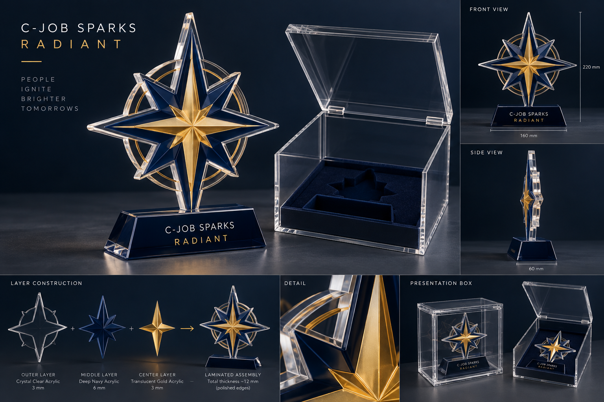

# Radiant physical award concept

The approved software workflow supports two physical Radiant reward variants:

1. `RadiantAcrylic` — a layered acrylic award in a fitted presentation box.
2. `RadiantVesselModel` — a rescaled, print-ready model of a project vessel exported from Rhino.

The selected variant, responsible person and current valuable-prize description are stored as a snapshot on every Radiant award. The valuable prize can therefore change each year without changing historical records.

## Acrylic concept

Proposed production envelope:

- finished height: approximately 220 mm;
- base width: approximately 160 mm;
- total laminated thickness: approximately 12 mm;
- layers: 3 mm clear cast acrylic, 6 mm deep navy acrylic, 3 mm translucent gold acrylic;
- polished laser-cut edges;
- laser engraving or UV print for `C-JOB SPARKS` and `RADIANT`;
- a fitted acrylic presentation box with a dark foam insert;
- recipient name, award reason and year remain variable production fields.

The concept is a visual brief, not a production drawing. Before ordering, the Rhino designer and manufacturer must confirm tolerances, minimum web thickness, balance, adhesive, engraving method and box clearances. The visual direction follows the manufacturer's documented capabilities for layered acrylic, laser cutting, engraving and UV printing: https://ufcolor.com.ua/ru/catalog_manufacturing/akrilovye-prizy/

## Vessel-model Rhino task

Required input:

- a project-owned Rhino model with explicit permission to use it for an employee award;
- confirmation that the project is not subject to client confidentiality restrictions;
- the intended printing process and printer build volume.

Required preparation:

1. Duplicate the source into a dedicated award file; never alter the project master.
2. Remove confidential geometry, metadata, drawings and client identifiers.
3. Repair open edges, naked surfaces, non-manifold geometry and self-intersections.
4. Simplify details that disappear at the final scale and thicken fragile elements.
5. Convert to a closed printable mesh and select a stable display orientation.
6. Rescale to the agreed presentation size and design a separate base.
7. Export STL or 3MF in millimetres and validate the exported mesh in the target slicer.
8. Produce a low-cost proof print before the final print and presentation-box order.

The responsible designer's time and reward must be agreed before work starts. A closed or confidential project may make this option unavailable; in that case the acrylic award is the default.
